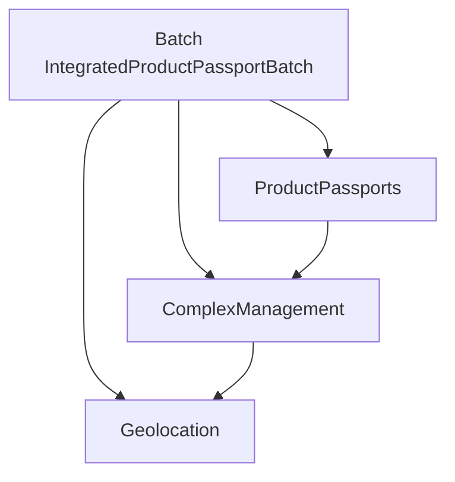

# Digital Product Passport Solidity SDK

TypeScript SDK for the [Digital Product Passport smart contracts](https://github.com/DigitalProductPassport/SmartContracts), built on [ethers v6](https://docs.ethers.org/v6/). It deploys and wires the contracts, wraps every contract function with typed inputs and outputs, and uploads product documents to IPFS through [Pinata](https://www.pinata.cloud/).

Published on npm as [`@digitalproductpassport/solidity-sdk`](https://www.npmjs.com/package/@digitalproductpassport/solidity-sdk).

## What is a Digital Product Passport?

A Digital Product Passport (DPP) is a digital record that follows a product from design to disposal. It collects data about material sourcing, manufacturing, certifications and lifecycle events, and makes that data available to manufacturers, consumers, recyclers and repair services. A physical product links to its passport through an NFC chip, QR code or RFID tag.

## Contracts

The SDK has one client per contract. Every contract is `Ownable`: only the owner can write.

| SDK client                                       | Contract                         | Purpose                                                                                                                                                                              |
| ------------------------------------------------ | -------------------------------- | ------------------------------------------------------------------------------------------------------------------------------------------------------------------------------------ |
| [`Geolocation`](docs/Geolocation.md)             | `Geolocation`                    | Locations (latitude, longitude, extra info) stored under a string ID.                                                                                                                |
| [`ComplexManagement`](docs/ComplexManagement.md) | `ComplexManagement`              | Production sites ("complexes") and their locations.                                                                                                                                  |
| [`ProductPassports`](docs/Product%20Passport.md) | `ProductPassport`                | Product data: description, manuals and specifications (IPFS hashes), batch number, dates, certifications, warranty, material composition and the complex where the product was made. |
| [`Batch`](docs/Batch.md)                         | `IntegratedProductPassportBatch` | ERC-721 token (`DPP`) per production batch, with amount, assembly time, transport details, and origin and current location.                                                          |



The contract bindings (ABI and bytecode) in [src/contracts](src/contracts) are generated by TypeChain in the SmartContracts repository. They are also exported as `contracts` for calls the clients do not wrap.

## Installation

```bash
npm install @digitalproductpassport/solidity-sdk
```

The SDK is an ES module and requires Node.js 22.10 or later.

## Configuration

The SDK reads its defaults from environment variables, loaded from a `.env` file with `dotenv`. Copy [.env.example](.env.example) and fill in the values you need.

| Variable                                  | Used by                     |
| ----------------------------------------- | --------------------------- |
| `PROVIDER_URL`                            | `Config.createSigner`       |
| `PRIVATE_KEY`                             | `Config.createSigner`       |
| `GEOLOCATION_ADDRESS`                     | `Geolocation`               |
| `COMPLEX_MANAGEMENT_ADDRESS`              | `ComplexManagement`         |
| `PRODUCT_PASSPORT_ADDRESS`                | `ProductPassports`          |
| `PRODUCT_PASSPORT_BATCH_ADDRESS`          | `Batch`                     |
| `PINATA_API_KEY`, `PINATA_SECRET_API_KEY` | Pinata uploads              |
| `PRODUCT_DETAILS_FILE`                    | `Config.loadProductDetails` |

Every value can also be passed in code.

## Usage

### Deploy the full system

`deploySystem` deploys the four contracts and wires them the same way as the SmartContracts Ignition module, including the transfer of `Geolocation` ownership to `ComplexManagement`.

```typescript
import { Config, deploySystem } from '@digitalproductpassport/solidity-sdk';

const signer = Config.createSigner(); // PRIVATE_KEY + PROVIDER_URL

const { geolocation, complexManagement, productPassport, batch, addresses } =
  await deploySystem(signer);

console.log(addresses); // store these, e.g. in your .env
```

Pass `{ initialOwner }` to hand ownership of the contracts to another address after wiring, and `{ gweiBid }` to set the gas price.

### Connect to a deployed system

```typescript
import { Config, connectSystem } from '@digitalproductpassport/solidity-sdk';

// Addresses that are not given are read from the environment.
const system = connectSystem(Config.createSigner(), {
  productPassport: '0x...',
});
```

Each client can also be created on its own:

```typescript
import { ProductPassports } from '@digitalproductpassport/solidity-sdk';

const passports = new ProductPassports(signer, { address: '0x...' });
```

### Register a complex, a product and a batch

```typescript
// 1. A production site and its location
await complexManagement.addComplex('COMPLEX-1', {
  complexName: 'Vitoria Plant',
  complexCountry: 'Brazil',
  complexAddress: 'Av. Industrial, 100',
  complexSiteType: 'Factory',
  complexIndustry: 'Food',
  geolocationId: 'GEO-COMPLEX-1',
  latitude: '-20.3155',
  longitude: '-40.3128',
  additionalInfo: 'Main production site',
});

// 2. A product made at that complex
await productPassport.createProduct(1, {
  description: 'Brigadeiro',
  manuals: ['QmManualHash'],
  specifications: ['QmSpecHash'],
  batchNumber: 'BRG-2026-001',
  productionDate: '2026-06-20',
  expiryDate: '2026-12-31',
  certifications: 'FDA-5678',
  warrantyInfo: 'Not applicable',
  materialComposition: ['0x0000000000000000000000000000000000000001'],
  complexId: 'COMPLEX-1',
});

const { product, origin } = await productPassport.getProductDetails(1);

// 3. A batch of that product, minted as an NFT
await batch.createBatch(1, {
  amount: 100,
  assemblingTime: 3600,
  transportDetails: 'Truck BR-101',
  productId: 1,
});
await batch.setTokenURI(1, 'ipfs://QmBatchMetadata');

const details = await batch.getBatchDetails(1, 1);
// details.batch, details.product, details.complex, details.currentLocation, details.originLocation
```

Write methods return the transaction receipt. Failed calls throw an `Error` whose message includes the revert reason, for example `Failed to create product: Complex does not exist`.

### Upload product documents to IPFS

```typescript
import { DocumentLoaderToIPFS } from '@digitalproductpassport/solidity-sdk';

const { manuals, specifications } = await DocumentLoaderToIPFS(
  'product-config.json',
);
```

See [docs/utils/passportDocumentLoader.md](docs/utils/passportDocumentLoader.md) and [docs/utils/pinata.md](docs/utils/pinata.md).

## Known limitations

These come from the current contracts:

- `Geolocation` has a single owner, and `deploySystem` gives it to `ComplexManagement`. `Batch.updateBatchLocation` can therefore only move a batch to a geolocation that already exists, such as the location of another complex. Creating a new location from that call reverts.
- A product's complex and a complex's geolocation cannot be changed after creation.
- `Geolocation` validates coordinates only by string length (1 to 20 characters), not by numeric range.

## Development

```bash
npm install
npm test        # Mocha tests on an in-process Hardhat network
npm run lint
npm run build   # compiles to dist/
```

Hardhat is a development dependency used only to run the tests. The SDK deploys the contracts from the bytecode in `src/contracts`.

### Updating the contract bindings

When the contracts change, rebuild them in the SmartContracts repository and copy the generated bindings:

```bash
cd ../SmartContracts && npx hardhat build && cd -
npm run sync-contracts -- ../SmartContracts
npm test
```

The script copies `types/` into `src/contracts`, skipping the Echidna test harness.

## License

MIT. See [LICENSE](LICENSE).
